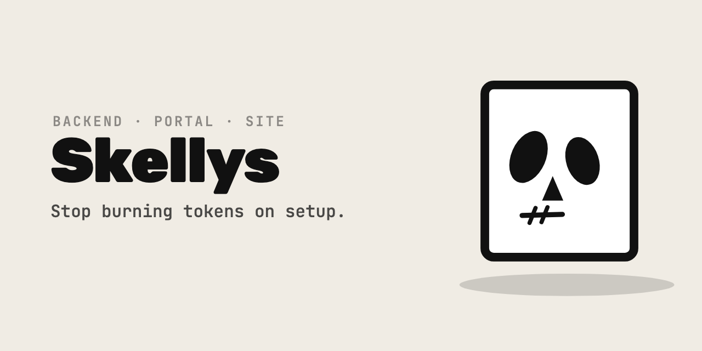

# skelly-mono

A bun workspace root that holds no application code.

Clone it bare and you get an empty monorepo: a workspace declaration, a shared TypeScript
base config, and the two directories the applications will land in. Nothing runs, because
there is nothing to run yet.

The code arrives by mounting. `bun run mount` composes the Skelly templates into `apps/`:

```bash
bun run mount --help
bun run mount --slug acme --apps server,portal,site --design-system --dry-run
```

`mono.json` is the specification — the catalogue of mountable containers and the
design-system recipe, as data. `scripts/mount.ts` is the compiler that reads it. Planning is
pure and separate from the filesystem effects, so `--dry-run` prints the exact plan that a
real run will execute, rather than a description of one.

## Layout

```
apps/           the deployable containers — server, portal, site, or your own
packages/       shared code. Created only if you accept the design system
scripts/        the compiler and the tRPC contract sync
mono.json       the container catalogue and the design-system recipe
```

## The templates it mounts

| Container | Template |
|---|---|
| `apps/server` | [skelly-backend](https://github.com/yeahitsmejayyy/skelly-backend) — Bun, SQLite, tRPC |
| `apps/portal` | [skelly-portal](https://github.com/yeahitsmejayyy/skelly-portal) — React 19, Vite, Tailwind, shadcn/ui |
| `apps/site`   | [skelly-site](https://github.com/yeahitsmejayyy/skelly-site) — marketing site, fourteen sections |

Each of those is also fine alone. This repository exists for the case where you want several
of them in one workspace, with one lockfile and one shared component package.

## Mounting detaches

The mount clones each template shallowly, strips its `.git`, applies the renames, deletes the
files that are about Skelly rather than about your project, and leaves you with your own
repository from its first commit. There is no fork relationship and no remote pointing back
here, which is deliberate — a starter you keep syncing with is a framework, and this is not
one.

`LICENSE` is deleted rather than rewritten, so a mounted project carries no licence until you
add one.
